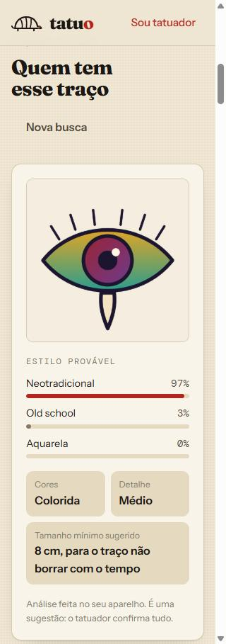
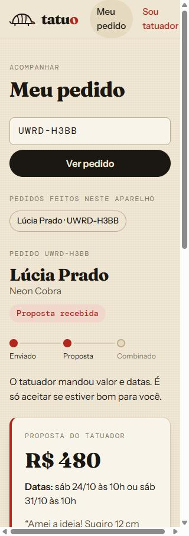
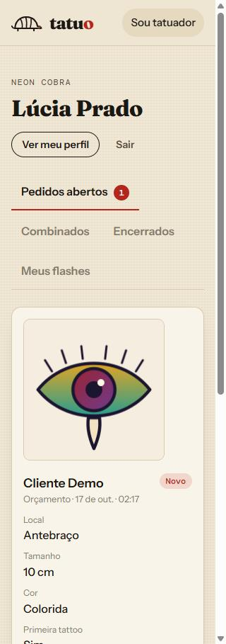
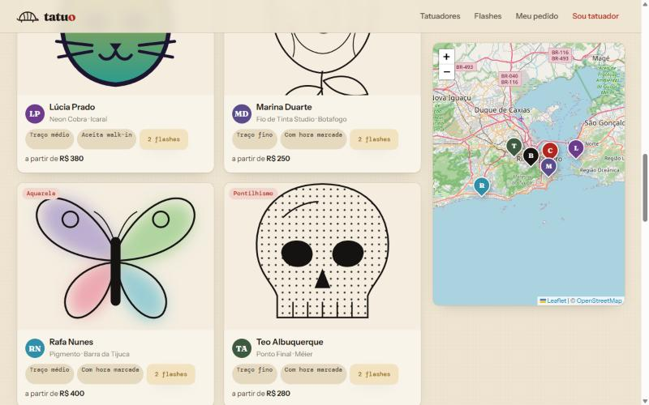

# tatuo

**Ache o traço. Ache quem tatua.**

O Tatuo junta **"eu tatuo"** com **tatu**, o bicho: o mascote é um tatuzinho, cuja carapaça lembra traço de tatuagem.

É um app que liga quem quer fazer uma tatuagem a quem tatua. O cliente manda uma referência, a **IA identifica o estilo e mostra os tatuadores com o traço mais parecido**, perto dele. Depois ele monta o pedido completo (local do corpo, tamanho e uma prévia numa foto do próprio braço) e o tatuador responde com valor e datas num painel próprio.


> Protótipo de portfólio. Os 6 tatuadores, estúdios e artes são fictícios. As artes foram geradas por código em [`scripts/gerar_obras.py`](scripts/gerar_obras.py).

## O problema

Hoje o orçamento de tatuagem acontece por DM no Instagram: o cliente manda uma foto solta e pergunta "quanto fica?". O tatuador tem que perguntar de novo o local, o tamanho, se tem cor e se é a primeira tatuagem. E quem está começando nem sabe qual tatuador trabalha no estilo que quer.

## O que o app faz

**Para o cliente**
- **Busca por referência:** solta uma imagem (ou descreve: "cobra em preto chapado") e a IA mostra quem tem o traço mais parecido.
- **Análise da referência:** estilo provável, se é colorida, nível de detalhe e tamanho mínimo pra não borrar com o tempo.
- **Catálogo:** filtros por estilo, preço e "perto de mim", com mapa dos estúdios.
- **Flashes à venda:** desenhos prontos com preço fechado. Peças únicas saem do catálogo assim que alguém reserva.
- **Pedido em 4 etapas:** referência, local do corpo numa silhueta (frente e costas), **prévia numa foto do corpo** (arrastar, girar, redimensionar) e dados de contato.
- **Acompanhar pelo código:** sem criar conta. Vê a proposta, aceita ou desiste.

**Para o tatuador**
- Painel com os pedidos que chegaram: referência, local, tamanho, estilo detectado e contato (link direto pro WhatsApp ou Instagram).
- Mandar proposta (valor, datas e mensagem), recusar com explicação ou arquivar.
- Publicar flashes e esconder ou mostrar cada um no catálogo.

| Análise da IA | Prévia na pele | Proposta para o cliente | Painel do tatuador |
|---|---|---|---|
|  |  |  |  |



## A IA: grátis, no navegador e sem enviar a imagem

A IA usa o modelo **CLIP** (OpenAI, versão aberta) rodando **no navegador** com a [Transformers.js](https://huggingface.co/docs/transformers.js). Não tem API paga nem servidor de IA: o custo é zero e a imagem nunca sai do aparelho. Na primeira vez o navegador baixa o modelo (~150 MB) e depois ele fica em cache.

O CLIP transforma imagens e textos em vetores de 512 números, e coisas parecidas viram vetores parecidos. O app usa isso de três jeitos:

1. **Estilo por poucos exemplos.** O app não depende de frases fixas: cada estilo é representado pela média dos vetores dos trabalhos daquele estilo no portfólio dos tatuadores. A referência é comparada com essas médias. **Quanto mais trabalhos os tatuadores publicam, melhor a IA fica.**
2. **Medidas do traço.** O CLIP presta mais atenção no tema do desenho (uma caveira) do que no jeito de desenhar (old school ou blackwork). Por isso o app também mede, nos pixels, quanta cor tem, quanta tinta, quantas bordas e a espessura da linha. Essas medidas são padronizadas e comparadas com as médias de cada estilo, junto com o CLIP.
3. **Busca por texto.** A descrição em português passa por uma tradução simples de palavras-chave e é comparada com os trabalhos do portfólio.

**Resultado:** usando os 12 flashes de demonstração como referência (imagens que não estão no portfólio), a IA acertou **10 de 12 estilos**. Só com as frases em inglês do CLIP, eram 5. Os dois erros foram confusões próximas, como cobra old school com cobra neotradicional (as duas coloridas).

**Limitação conhecida:** as artes de demonstração repetem os mesmos temas (rosa, cobra, caveira) em estilos diferentes, que é o pior caso pro CLIP. Com portfólios reais, de temas variados, a separação por estilo tende a ser melhor.

## Privacidade

- **A foto do corpo nunca é enviada.** A prévia usa `URL.createObjectURL` e acontece só no navegador.
- **A análise da IA roda no aparelho.** Ao tatuador vai só o resumo ("Neotradicional, 97%").
- **O tatuador recebe** a referência, os dados do formulário e o contato. Os [termos](frontend/termos.html) explicam isso em linguagem simples, com os direitos da LGPD.
- **Imagens enviadas são validadas pelo conteúdo.** O servidor confere a assinatura do arquivo (JPG, PNG ou WebP), não só a extensão, e salva com nome aleatório, até 5 MB.

## Tecnologias

- **Back-end:** Python 3.13 e FastAPI, com documentação automática em `/docs`
- **Banco:** SQLite com SQL escrito à mão, `CHECK`, chaves estrangeiras e índices ([`app/schema.sql`](app/schema.sql))
- **Login do tatuador:** JWT e senha com hash Argon2. Clientes não precisam de conta.
- **Front-end:** HTML, CSS e JavaScript puro (módulos ES), sem build, servido pela própria API
- **IA:** Transformers.js com CLIP (`Xenova/clip-vit-base-patch32`) no navegador
- **Mapa:** Leaflet e OpenStreetMap (grátis)
- **Testes:** 26 testes de API com pytest, no GitHub Actions
- **Deploy:** Dockerfile com banco e uploads num volume

Detalhes de implementação:

- **Distância:** a fórmula de haversine calcula a distância em km, e a lista sai ordenada do mais perto ao mais longe ([`app/geo.py`](app/geo.py)).
- **Duas pessoas reservando o mesmo flash ao mesmo tempo:** `UPDATE flash SET disponivel = 0 WHERE id = ? AND disponivel = 1` é atômico. Só um dos pedidos muda a linha; o outro recebe 409.
- **Código do pedido sem confusão:** 8 caracteres de um alfabeto sem O/0 e I/1/L (31⁸ ≈ 850 bilhões de combinações), gerados com `secrets`.
- **Cache que não engana:** o servidor manda `Cache-Control: no-cache` nos arquivos do site. O navegador pode guardar, mas confere a versão (ETag) antes de usar, então ninguém fica com versão velha depois de uma atualização.

## Como rodar

```bash
git clone https://github.com/Vwhatrj/tatuo.git
cd tatuo
python -m venv .venv
.venv\Scripts\activate          # Linux/macOS: source .venv/bin/activate
pip install -r requirements.txt
copy .env.example .env          # Linux/macOS: cp .env.example .env
uvicorn app.main:app --reload
```

Abra http://127.0.0.1:8000. No primeiro start são criados os 6 tatuadores de demonstração. Para entrar no painel, use `marina-duarte@exemplo.com` (ou o slug de qualquer outro tatuador, como `caio-ramos@exemplo.com`) com a senha definida em `SENHA_DEMO` (no exemplo, `tatuo-demo`).

Para refazer as artes de demonstração:

```bash
python -m scripts.gerar_obras
```

**Com Docker:**

```bash
docker build -t tatuo .
docker run -p 8000:8000 -e SENHA_DEMO=tatuo-demo -e JWT_SECRET=um-segredo-longo -v tatuo:/dados tatuo
```

**Testes:**

```bash
pytest -v
```

## API (resumo)

| Método | Rota | Acesso | O que faz |
|---|---|---|---|
| GET | `/api/estilos` | aberto | Estilos que o app conhece |
| GET | `/api/tatuadores?estilo=&preco_max=&busca=&lat=&lng=&raio_km=` | aberto | Busca com filtros e distância |
| GET | `/api/tatuadores/{slug}` | aberto | Perfil, portfólio e flashes |
| GET | `/api/trabalhos` | aberto | Portfólios (usados pela IA) |
| GET | `/api/flashes` | aberto | Flashes disponíveis |
| POST | `/api/pedidos` | aberto | Envia um pedido (multipart, com a imagem) |
| GET | `/api/pedidos/{codigo}` | quem tem o código | Acompanha o pedido |
| POST | `/api/pedidos/{codigo}/aceitar` · `/cancelar` | quem tem o código | Aceita a proposta ou desiste |
| POST | `/api/auth/token` | aberto | Login do tatuador |
| GET | `/api/painel/pedidos?situacao=` | tatuador | Pedidos recebidos |
| POST | `/api/painel/pedidos/{id}/responder` · `/recusar` · `/arquivar` | tatuador | Proposta, recusa ou arquivo |
| GET, POST, PATCH | `/api/painel/flashes` | tatuador | Publicar e esconder flashes |

## Próximas fases

- **Pagamento pelo app:** sinal ou valor total, com antes, depois ou presencial, e PIX, cartão ou dinheiro. O dinheiro é liberado depois que os dois confirmam. No protótipo, com o modo de teste do Mercado Pago.
- **Destaque pago** para o tatuador aparecer primeiro no catálogo.
- **Avaliações com foto cicatrizada,** 30 dias depois da sessão.
- **Cuidados pós-tatuagem:** lembretes nos dias 1, 3 e 7 e aviso de retoque.
- **Agenda de sessões** e aviso por WhatsApp.
- **Cadastro de tatuadores** pelo próprio app, com edição de perfil e portfólio.

## Sobre

Projeto pessoal de **Guilherme Santos Souza**, estudante de Engenharia da Computação na UVA. Desenvolvido com apoio do Claude Code.

[GitHub](https://github.com/Vwhatrj) · [LinkedIn](https://linkedin.com/in/guipessoal800)
